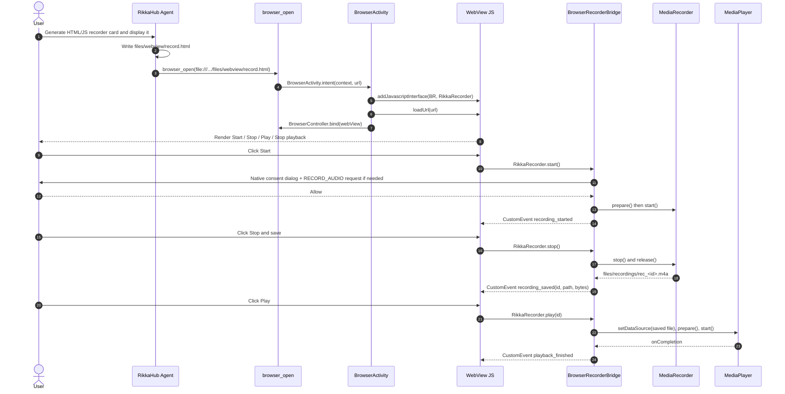

# Design approaches — WebView file scheme

## For human fast reading:
**Selected:** change model tool's scheme decision and use a shared canonical path policy; retain existing WebView file settings to preserve skill pages. **Open risk:** `allowFileAccessFromFileURLs=true` in existing browser configuration can enable local-file script access outside the tool's path allowlist. The feature must not be advertised as a secure viewer for untrusted local HTML. [Review](topics/review-file-scheme.md) distinguishes actual guarantees.

## Components and sequence
1. Model → `browserOpenTool(context, invocationContext)` (`BrowserTools.kt`) with `url`.
2. Tool checks missing URL and scheme; for `file`, calls `BrowserFileSchemePolicy.isAllowed(url, stagedRoots, skillsRoot)`.
3. `isAllowed` parses `java.net.URI`, requires absolute file path and no URI authority, canonicalizes the actual file and root, requires an existing regular file. Named skill directories enforce a web-asset extension allowlist and no hidden path components.
4. If denied, tool returns `file_access_denied` before creating/launching browser. If accepted, existing foreground `BrowserActivity` or headless `HeadlessBrowserSession` uses `WebView.loadUrl`.
5. `BrowserView` and `HeadlessBrowserSession` call `blockPageFileNavigation` for page-initiated file top-level URL changes. Remote→file and local→disallowed-file are blocked. Both otherwise keep pre-existing behavior.
6. `configureWebViewForRikka` supplies existing settings to both hosts, including file access and file-origin subresource allowance. SkillWebviewCard opens app-authored URLs independently of the Agent's tool.

## Actual allowed paths
- `context.filesDir/webview/` — staging directory for trusted local browser pages.
- `context.cacheDir/skill-webview/` — generated iframe wrappers.
- `context.filesDir/skills/<skill-name>/` — **existing web asset types only**, based on `FileFolders.SKILLS = "skills"`; no `.env` or `SKILL.md` tool navigation.

## Threat model and limits
The `browser_open` path guard prevents *direct model-requested navigation* to arbitrary private files. `shouldOverrideUrlLoading` is a partial top-level navigation guard, **not an authorization check on all WebView subresources, XHR/fetch, redirects or JavaScript file reads**. Existing `allowFileAccessFromFileURLs=true` makes an allowed malicious HTML page potentially dangerous; a web asset extension does not prove content is trusted. Consequently "no private file disclosure" must never be claimed categorically. A future security-hardening ticket should isolate local content using a separate viewer / WebViewAssetLoader HTTPS origin and test cross-origin requests, without regressing local skill assets.

## Rejected alternatives
- Add `file` to the scheme set with no path filtering: immediate direct secret-file exposure.
- Allow arbitrary external storage: Android storage permissions and trust model out of scope.
- Change all skill URLs to HTTPS now: broader migration, needs device-level compatibility validation.
- Disable `allowFileAccessFromFileURLs` without testing: could break existing skill assets; requires focused compatibility tests on Mac/device.

See [decisions](decisions.md), [browser contract](modules/m-browser/spec.md) and [concrete implementation](modules/m-browser/impl.md).

## t-record: HTML WebView → Android recording architecture

`BrowserActivity.onWebViewReady` installs `BrowserRecorderBridge` via `wv.addJavascriptInterface(bridge, "RikkaRecorder")` **before** `BrowserView.WebViewHost` calls `loadUrl(initialUrl)`. The Agent's already-existing model `browser_open` still loads trusted HTML from `files/webview`. No new model recording tool or extension of the `file://` allowlist is necessary.

Bridge JS methods `start()`, `stop()`, `play(recordingId)`, `stopPlayback()` marshal immediately to Android UI thread. Every call rechecks the current top-level URL using `BrowserRecorderPagePolicy.isTrusted` (absolute existing canonical HTML inside `files/webview`). `start()` shows a native confirmation every time and uses ActivityResultContracts.RequestPermission on Android RECORD_AUDIO. The recorder writes a private m4a file with a generated opaque ID; player uses only IDs with a fixed regex, resolves only `files/recordings/<id>.m4a`, then invokes native MediaPlayer. Returned JS event has shape `{type, code?, id?, fileName?, absolutePath?, bytes?}`. The page obtains no arbitrary Java file read API. On Activity stop/destroy or navigation, native capture/playback is stopped; maximum recording duration is 300 seconds.

**Security:** Android `addJavascriptInterface` is available to all frames, not just main frame; the bridge's top-level URL restriction and explicit native start confirmation reduce but do NOT eliminate untrusted iframe/content risks. Only trusted local HTML with trusted scripts/iframes must be used. Existing `allowFileAccessFromFileURLs=true` remains a separate file-origin security concern. Do not enable recording automatically or expose a no-consent start option. For production-grade capability isolation, move card content to an authenticated WebMessageListener origin with frame identity checks and a tightly controlled origin, and isolate arbitrary user-generated HTML; this is an explicitly documented unresolved hardening task.

Data path: Agent writes HTML → `browser_open` → `BrowserFileSchemePolicy` → `BrowserActivity` installs Bridge → `WebView.loadUrl` → HTML click → `RikkaRecorder.start` → Android consent + permission → `MediaRecorder` → HTML stop → `MediaRecorder.stop` → `CustomEvent("rikka-recorder")` with recording ID → HTML play → Android `MediaPlayer` → completion event.

### t-record navigation/permission race protection
The `BrowserRecorderBridge` captures `pendingPageUrl` on request, verifies it on permission-result callback and dismisses pending confirmation on page navigation. Navigation during recording stops it; playback is also stopped when leaving a trusted local card. The browser controller is bound only **after** `loadUrl(initialUrl)` is issued, though the recorder interface is installed before it. This is required for `browser_open` readiness semantics.

### t-record exact Android bridge sequence

This sequence applies to **visible BrowserActivity** only. No direct JS → existing `record_audio` Agent tool invocation is implied, and the sample is not an inline Compose chat WebView. Mac hardware acceptance must test this actual sequence.

### t-record playback navigation ownership
Both `MediaRecorder` and `MediaPlayer` are now bound to the **exact initiating top-level WebView URL**. The bridge tracks `activePageUrl` during capture and `playbackPageUrl` during audio playback, and releases the respective resources when `BrowserActivity.onUrlChange` reports any different URL, even when the new URL is another approved local card. Background and Activity destruction also release resources.
